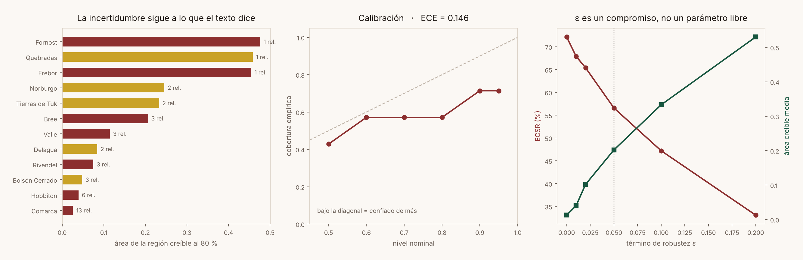

# Resolución probabilística de restricciones espaciales narrativas

Prototipo del Seminario de Título de **Nehemías Leiva**, Ingeniería Civil en
Informática, Pontificia Universidad Católica de Valparaíso.
Profesor guía: Ignacio Araya Zamorano · Profesora correferente: Leslie Pérez Cáceres.

---

## Qué hace

Toma las relaciones espaciales que un modelo de lenguaje extrajo de una
novela —«Bree está al oeste de la Comarca», «Erebor está cerca de Valle»— y
en lugar de buscar **una** disposición del mapa que las satisfaga, calcula
**la distribución completa** de disposiciones compatibles con el texto.

La salida no es una coordenada por lugar. Es, por cada lugar, un mapa de
calor que dice dónde puede estar y con cuánta confianza.


Donde el texto habla mucho de un lugar la mancha es chica. Donde lo
menciona una sola vez, la mancha se abre. Donde se contradice, se parte.
Esa información existe en el texto y el enfoque determinista la descarta.

---

## Por qué, en una línea

El trabajo base de referencia (Díaz Ureta y Mercado Meza, 2026) resuelve el
mismo problema con Z3 y restricciones duras: cuando dos pasajes se
contradicen, descarta uno y entrega una coordenada de apariencia exacta.
Este prototipo conserva la contradicción y la reporta.

---

## El resultado que importa

Sobre **exactamente la misma entrada** —la extracción congelada de `run_01`
que los autores publicaron en su repositorio, sin volver a llamar al modelo
de lenguaje— y evaluando los tres candidatos en el mismo marco, con el
mismo predicado duro y las mismas 10 relaciones:

| Configuración | CSR |
|---|---|
| Sistema base, Z3 con 120 s de presupuesto | 70,00 % |
| Este modelo, configuración de máxima densidad | **80,00 %** |
| **El propio mapa oficial de la Tierra Media** | **50,00 %** |

La última fila es el hallazgo. **El mapa verdadero saca 50 %.** La mitad de
las relaciones extraídas no son compatibles con la geografía real, de modo
que el techo que ningún solver puede superar sin inventar está en 50 %, y
el sistema base lo supera.

Un CSR alto, entonces, no mide fidelidad al mundo: mide ajuste a los
errores de la extracción. Es el segundo argumento independiente contra usar
CSR como objetivo. El primero salió de la verificación del trabajo base: en
sus diez ejecuciones publicadas, la correlación entre número de
restricciones y CSR es **r = −0,67**, es decir que una ejecución mejora su
CSR simplemente extrayendo menos.

Advertencia honesta: son 10 relaciones sobre 7 lugares. Es un indicio
fuerte, no una medición concluyente. Extenderlo es trabajo de 2027.

---

## Las otras tres mediciones



**La incertidumbre sigue a lo que el texto dice.** Correlación entre número
de relaciones de un lugar y el área de su región creíble: **r = −0,60**.
La Comarca aparece en 13 relaciones y su área es 0,026; Fornost aparece en
una y su área es 0,476. El modelo no sabe dónde está Fornost, y lo dice.

**Calibración.** Error de calibración esperado 0,146 sobre los 7 lugares con
posición oficial conocida. La curva va por debajo de la diagonal: el modelo
es algo confiado de más, que es el modo de fallo que hay que vigilar.

**ε no es un parámetro libre.** El término de robustez controla un
compromiso medido, no una preferencia:

| ε | ECSR | área creíble media | ECE |
|---|---|---|---|
| 0,00 | 72,2 % | 0,013 | 0,694 |
| 0,02 | 65,4 % | 0,102 | 0,313 |
| 0,05 | 56,6 % | 0,202 | 0,265 |
| 0,10 | 47,2 % | 0,333 | 0,123 |
| 0,20 | 33,1 % | 0,530 | 0,075 |

Sin robustez el modelo es nítido y está pésimamente calibrado. Con mucha
robustez está bien calibrado y no dice nada. El valor por defecto, 0,05, no
es el óptimo de calibración: elegirlo bien es un problema de configuración
automática de algoritmos con una regla de puntuación propia como objetivo,
y eso es trabajo de OE3.

---

## Cómo correrlo

```bat
python -m venv .venv
.venv\Scripts\activate
pip install -r requirements.txt
CORRER.bat
```

O paso a paso:

```bat
python pipeline\1_preparar_subgrafo.py     :: lee la extracción, elige el subgrafo
python pipeline\2_muestrear.py             :: 4 cadenas MCMC, ~12 s
python pipeline\3_mapas_calor.py           :: figuras por entidad
python pipeline\4_comparar.py              :: métricas y barrido de epsilon
```

El paso 1 busca la extracción en `../5 Sistema base/experimentos/resultados/
con_ambiguas/run_01/json/map_relations.json`. Si la tienes en otro lugar,
pásale la ruta como argumento.

**No se necesita clave de API.** La extracción está congelada a propósito:
es lo que hace que cualquier diferencia de resultado venga de la etapa de
resolución y no del modelo de lenguaje.

### Pruebas

```bat
python pruebas\test_modelo.py
```

Catorce pruebas. Las dos que importan son
`test_sin_epsilon_gana_el_punto_medio` y
`test_epsilon_rescata_la_bimodalidad`: juntas demuestran por qué el término
de robustez tiene que estar. Si esas fallan, el aporte central no se
sostiene. Es la condición A1 del diseño experimental del informe.

---

## Cómo está armado

```
mapa_probabilistico/
  modelo.py      compatibilidades blandas, término de robustez, densidad objetivo
  muestreo.py    Metropolis-Hastings por bloques, Gelman-Rubin, tamaño efectivo
  metricas.py    ECSR, nitidez, calibración, alineamiento al grafo oficial
  datos.py       carga de la extracción y verdad de referencia
pipeline/        los cuatro pasos, numerados
pruebas/         pruebas del modelo
salida/          figuras y resultados
```

### El modelo en tres piezas

**Restricción blanda.** «Cerca de» no es un umbral, es una sigmoide:
μ(d) = 1 / (1 + exp((d − d₀)/s)). Vale 0,5 exactamente en d₀ y decae suave.
Con s → 0 se recupera el escalón duro del sistema base, así que la
restricción dura es el caso límite de esta y no al revés. Las direcciones
cardinales usan un cono graduado, μ(θ) = max(0, cos θ)^k, en el sentido de
Frank (1996).

**Término de robustez.** μ̃ = ε + (1 − ε)·μ. Sin él, dos referencias
contradictorias producen un máximo espurio en el punto medio, donde no hay
evidencia de nada: las colas de las dos sigmoides se multiplican y le ganan
a las dos posiciones que sí satisfacen una. Con él, violar cuesta log(ε), que
es caro pero finito, y reaparecen los dos modos verdaderos.

**Muestreo.** Metropolis-Hastings por bloques: cada paso mueve un lugar y
solo reevalúa las relaciones que lo tocan. Cuatro cadenas con semillas
declaradas, Gelman-Rubin R = 1,0013, tamaño efectivo mínimo 2.929 de 80.000.

### Reproducibilidad

El presupuesto está declarado en el código y escrito en
`salida/diagnostico_muestreo.json`: semillas, número de cadenas, descarte,
tiempo. Eso es deliberado. La verificación del trabajo base mostró que su
CSR recorre 16,67 puntos porcentuales entre equipos, con la extracción
congelada, porque Z3 corta a los 120 segundos y nadie declaró ese
presupuesto.

---

## Alcance

Esto es una rebanada vertical sobre 12 lugares y 20 relaciones, no el
sistema completo. Falta, y es trabajo de 2027:

- Tipado geométrico: hoy toda entidad es un punto. Faltan regiones y curvas.
- Escalar a los 63 lugares, que son 126 dimensiones.
- Pesos de confianza reales, que salen de M extracciones del modelo de
  lenguaje. Hoy todos valen 1 porque la extracción congelada no publica
  confianza. La formulación ya los admite.
- Ajustar ε y los demás parámetros con configuración automática y una regla
  de puntuación propia, sobre instancias sintéticas con verdad conocida,
  para no gastar el corpus de evaluación en el ajuste.

---

## Datos

Extracción de entrada: `experimentos/resultados/con_ambiguas/run_01/json/map_relations.json`
del repositorio `github.com/benjadiazu/mapasAPartirDeTexto`, commit `00b7fca`,
publicado por Díaz Ureta y Mercado Meza. Texto de origen: *La Comunidad del
Anillo I*. Verdad de referencia: grafo oficial de la Tierra Media incluido en
ese mismo repositorio.
