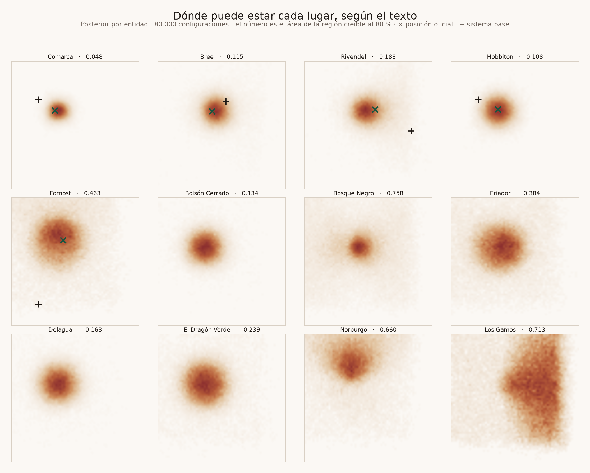
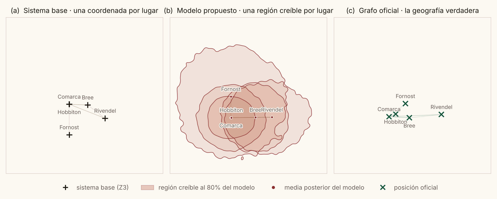

# Resolución probabilística de restricciones espaciales narrativas

Prototipo del Seminario de Título de **Nehemías Leiva**, Ingeniería Civil en
Informática, Pontificia Universidad Católica de Valparaíso.
Profesor guía: Ignacio Araya Zamorano · Profesora correferente: Leslie Pérez Cáceres.

---

## Qué hace

Toma las relaciones espaciales que un modelo de lenguaje extrajo de una
novela —«Bree está al este de la Comarca», «Hobbiton está cerca de la
Comarca»— y, en lugar de buscar **una** disposición del mapa que las
satisfaga, calcula **la distribución completa** de disposiciones compatibles
con el texto.

La salida no es una coordenada por lugar. Es, por cada lugar, un mapa de
calor que dice dónde puede estar y con cuánta confianza.



Donde el texto habla mucho de un lugar la mancha es chica. Donde lo menciona
una sola vez, la mancha se abre. Donde se contradice, se parte. Esa
información está en el texto y el enfoque determinista la descarta.

---

## Por qué

El trabajo base de referencia (Díaz Ureta y Mercado Meza, 2026) resuelve el
mismo problema con Z3 y restricciones duras: cuando dos pasajes se
contradicen, descarta uno y entrega una coordenada de apariencia exacta.
Este prototipo conserva la contradicción y la reporta.



A la misma escala, las regiones creíbles del modelo son grandes frente a la
separación entre las entidades. Esa desproporción no es un defecto del
muestreo: es la respuesta a un texto que menciona esos lugares pocas veces y
de forma imprecisa. Entre los dos, el que afirma de más es el que entrega un
punto.

---

## Lo que no se puede afirmar, y por qué importa

La comparación por tasa de satisfacción de restricciones (CSR) **no
distingue los dos sistemas.** Esa métrica compara distancias contra un umbral
que ni el trabajo base ni la literatura que lo precede declaran, de modo que
su valor queda a discreción de quien mide. Moviéndolo dentro de un rango
defendible, el orden se invierte:

| umbral cercanía / conectividad | sistema base | este prototipo | grafo oficial |
|---|---|---|---|
| 0,08 / 0,20 | 77,8 % | 66,7 % | 77,8 % |
| 0,12 / 0,20 | 88,9 % | 77,8 % | 77,8 % |
| 0,12 / 0,13 | 66,7 % | 77,8 % | 66,7 % |
| 0,15 / 0,20 | 88,9 % | 88,9 % | 88,9 % |
| 0,20 / 0,25 | 88,9 % | 88,9 % | 88,9 % |

Son nueve relaciones: cada una desplaza el indicador 11,1 puntos. El paso 4
publica este barrido en cada ejecución, precisamente para que ninguna cifra
de CSR pueda elegirse a conveniencia.

La fila del grafo oficial es un hallazgo por sí misma. **El mapa verdadero de
la Tierra Media obtiene 77,78 %**, el mismo valor que el prototipo y por
debajo del 88,89 % del sistema base. Un CSR alto no mide fidelidad a la
geografía del relato: mide ajuste a las relaciones efectivamente extraídas,
errores incluidos. Un sistema puede superar al mapa verdadero precisamente
porque optimiza sobre una extracción imperfecta.

### Lo que sí se sostiene

La similitud posicional contra el grafo oficial no depende de ningún umbral:

| | similitud posicional |
|---|---|
| Este prototipo, media posterior | **96,63 %** |
| Sistema base, Z3 con 120 s de presupuesto | 93,50 % |

La ventaja se mantiene entre 96,35 % y 96,97 % a lo largo de todo el barrido
de umbrales. Son 3,13 puntos sobre cinco lugares: un indicio, no una medición
concluyente.

Advertencia sobre la escala. El predicado compara distancias contra umbrales
absolutos, así que si cada candidato recibe la escala que mejor lo ajusta por
mínimos cuadrados, la escala se convierte en un grado de libertad que el
predicado premia: comprimir un mapa acerca todas sus entidades y satisface
las relaciones de distancia por construcción. El CSR de las tablas de arriba
se evalúa con una regla única y no ajustable, que iguala el radio de giro de
cada candidato al del grafo oficial. La similitud posicional sí usa el ajuste
óptimo, porque es una distancia y no un predicado con umbral.

---

## La extracción no es reproducible entre ejecuciones

Dos ejecuciones del extractor sobre **el mismo texto, el mismo modelo y el
mismo prompt**:

| | ejecución 1 | ejecución 2 | en ambas |
|---|---:|---:|---:|
| lugares | 66 | 55 | 33 |
| relaciones | 104 | 71 | **24** |

Índice de Jaccard de relaciones: **0,159**. De las 151 relaciones distintas
que ambas produjeron, solo 24 aparecen en las dos. Las cardinales son las más
inestables: `NORTE_DE` y `SUR_DE` no comparten ni una sola instancia.

Este es el argumento de raíz contra el CSR: no es que la métrica esté mal
medida, es que **la entrada misma no es reproducible**. Un CSR calculado
sobre una ejecución no es comparable con uno calculado sobre otra, aunque
ambos digan medir lo mismo sobre el mismo libro.

El hallazgo también justifica empíricamente los pesos de confianza derivados
de múltiples extracciones: una relación que aparece en varias ejecuciones es
evidencia de distinta calidad que una que aparece en una sola, y la densidad
del modelo ya admite un peso por relación. Por eso el extractor **nunca
sobrescribe** una ejecución anterior.

Detalle registrado en `HALLAZGO - inestabilidad de la extraccion.md`.

---

## La cobertura se mide contra una vara imposible

El trabajo base reporta una «cobertura de nodos» baja y la presenta como un
resultado pobre. Pero el grafo oficial cubre la Tierra Media entera —Minas
Tirith, Edoras, Mordor, Osgiliath— mientras que el texto de entrada es *La
Comunidad del Anillo I*, que transcurre casi completo entre la Comarca y
Rivendel.

`pipeline/5_techo_cobertura.py` cuenta, sobre el texto completo y
considerando los alias que el propio Tolkien usa, cuántos de los 33 lugares
del grafo oficial aparecen de verdad:

| | |
|---|---|
| Lugares en el grafo oficial | 33 |
| **Que el texto nunca nombra** | **18** |
| Que el texto sí nombra | 15 |
| Que la extracción encontró | 9 |

Dieciocho de los treinta y tres son inalcanzables por cualquier método,
porque pertenecen a volúmenes posteriores de la obra.

| Lectura | Valor |
|---|---|
| Cobertura como la reporta el trabajo base | 9/33 = 27,3 % |
| **Recall real sobre lo que sí es extraíble** | **9/15 = 60,0 %** |

Este hallazgo va a favor del trabajo base, y por eso vale más: el problema no
es que su sistema sea malo, sino que la métrica confunde la calidad de la
extracción con el solapamiento entre el texto y el grafo de referencia.

---

## Las otras mediciones


**La incertidumbre sigue a lo que el texto dice.** Correlación entre el número
de relaciones de un lugar y el área de su región creíble: **r = −0,515**. La
Comarca aparece en 15 relaciones y su área es 0,048; Fornost aparece en dos y
su área es 0,463. El modelo no sabe dónde está Fornost, y lo dice.

**Calibración: no tiene resolución aquí, y se reporta como tal.** La cobertura
empírica alcanza el 100 % en los seis niveles nominales, de modo que el error
de calibración esperado es 0,258 y no distingue configuraciones. Con solo
cinco lugares de posición conocida la métrica no informa nada, y por eso no
se usa como criterio. Medirla de verdad exige ampliar el conjunto de lugares
emparejados.

**ε no es un parámetro libre.** El término de robustez controla un compromiso
medido:

| ε | ECSR | área creíble media |
|---|---|---|
| 0,00 | 82,6 % | 0,137 |
| 0,01 | 79,6 % | 0,186 |
| 0,02 | 77,7 % | 0,184 |
| 0,05 | 72,3 % | 0,300 |
| 0,10 | 63,4 % | 0,336 |
| 0,20 | 45,7 % | 0,566 |

Sin robustez el modelo es nítido y frágil ante contradicciones. Con mucha
robustez es tolerante y no dice nada. Elegir el valor bien es un problema de
configuración automática de algoritmos con una regla de puntuación propia
como objetivo, y corresponde a una fase posterior del proyecto.

---

## Cómo correrlo

```bat
python -m venv .venv
.venv\Scripts\activate
pip install -r requirements.txt
```

Paso a paso:

```bat
python pipeline\1_preparar_subgrafo.py     :: lee la extracción, elige el subgrafo
python pipeline\2_muestrear.py             :: 4 cadenas MCMC, ~30 s
python pipeline\3_mapas_calor.py           :: figuras por entidad
python pipeline\4_comparar.py              :: métricas, barridos y comparación
python pipeline\5_techo_cobertura.py       :: el techo real de la cobertura
python pipeline\8_figura_comparacion.py    :: los tres mapas lado a lado
```

Los pasos 6 y 7 son auxiliares: `6_explicar_un_paso.py` imprime una iteración
completa del muestreador con sus números reales, y `7_condicion_P1.py` compara
el modelo con y sin tipado geométrico.

### Valores esperados

| Métrica | Valor |
|---|---|
| Subgrafo | 12 entidades, 23 relaciones |
| Gelman-Rubin, peor coordenada | 1,0021 |
| Tamaño efectivo de muestra, mínimo | 1.734 de 80.000 |
| ECSR del modelo | 71,63 % (σ 9,57) |
| Área creíble media al 80 % | 0,331 |
| Correlación grado–área | −0,515 |
| Similitud posicional, prototipo / sistema base | 96,63 % / 93,50 % |

**La resolución no necesita clave de API.** La entrada del modelo es un JSON
con dos listas, `lugares` y `relaciones`, y el repositorio incluye las
extracciones ya generadas. Esa independencia es deliberada: es lo que hace que
cualquier diferencia de resultado venga de la etapa de resolución y no del
modelo de lenguaje, y es la condición que vuelve válida la comparación cabeza
a cabeza con el trabajo base.

### Configurar la entrada

Todo lo que hay que tocar está en **`config.json`**. No se edita código. Cada
sección lleva su propia ayuda dentro del archivo, en las claves que empiezan
con guion bajo.

El modo del subgrafo tiene dos valores. Con `"lista"` se usan exactamente los
lugares indicados. Con `"auto"` el sistema los elige solo: parte de un lugar
semilla y crece por vecindad, priorizando los que tienen posición en el grafo
oficial y después los de mayor grado, de modo que el subgrafo es conexo por
construcción. **El modo `auto` es el que hay que usar con una extracción
nueva**, donde no se sabe de antemano qué lugares conviene tomar.

Los umbrales `d0_cerca` y `d0_conecta` no son parámetros libres: se anclan a
la mediana de las distancias reales entre los pares que el grafo oficial
permite verificar. Para la Tierra Media esa mediana es 0,124, de ahí el 0,12.
Son solo tres pares para la cercanía y cuatro para la conectividad, así que
se trata de una cota de cordura y no de una calibración. Por eso el paso 4
publica siempre el barrido de sensibilidad.

### Cómo probar con otro texto

**1. Otra extracción ya publicada o ya generada.** Funciona sin clave de API.
Cambia `entrada.ruta` en `config.json` y pon el subgrafo en `"auto"`, porque
los lugares que extrae cada ejecución no son los mismos.

**2. Un JSON escrito a mano.** Es lo más útil para probar el modelo de forma
controlada, porque permite construir casos con contradicciones conocidas:

```json
{
  "lugares": ["A", "B", "C"],
  "relaciones": [
    {"origen": "A", "tipo": "CERCA_DE", "destino": "B"},
    {"origen": "C", "tipo": "NORTE_DE", "destino": "B"}
  ]
}
```

Tipos admitidos: `CERCA_DE`, `CONECTA`, `NORTE_DE`, `SUR_DE`, `ESTE_DE`,
`OESTE_DE`. Sin grafo oficial no se pueden medir similitud posicional,
cobertura ni calibración, pero el muestreo y los mapas de calor sí.

**3. Una novela distinta.** Requiere ejecutar antes la etapa de extracción,
que sí necesita clave de API y saldo en la cuenta. El flujo es:

```
texto.pdf
   -> EXTRAER.py (etapa de extracción)   [requiere OPENAI_API_KEY]
   -> map_relations.json
   -> config.json apunta ahí
   -> todo lo demás igual
```

**Este sistema no cambia nada cuando llega un texto nuevo.** Lo único que
cambia es el JSON de entrada.

Para que la comparación con el sistema base siga siendo pareja, su solver debe
resolver **la misma** extracción. El paso 1 lo verifica comparando el conjunto
de relaciones que ese solver evaluó contra el de la extracción en uso, y avisa
cuando no coinciden.

### Pruebas

```bat
python pruebas\test_modelo.py
```

Veintidós pruebas. Las dos que importan son
`test_sin_epsilon_gana_el_punto_medio` y `test_epsilon_rescata_la_bimodalidad`:
juntas demuestran por qué el término de robustez tiene que estar. Si esas
fallan, el aporte central no se sostiene.

---

## Cómo está armado

```
mapa_probabilistico/
  modelo.py      compatibilidades blandas, término de robustez, densidad objetivo
  geometria.py   tipado geométrico: punto, curva y región
  muestreo.py    Metropolis-Hastings por bloques, Gelman-Rubin, tamaño efectivo
  metricas.py    ECSR, nitidez, calibración, alineamiento al grafo oficial
  datos.py       carga de la extracción y de la verdad de referencia
pipeline/        los pasos, numerados
pruebas/         pruebas del modelo
salida/          figuras y resultados
```

### El modelo en tres piezas

**Restricción blanda.** «Cerca de» no es un umbral, es una sigmoide:
μ(d) = 1 / (1 + exp((d − d₀)/s)). Vale 0,5 exactamente en d₀ y decae suave.
Con s → 0 se recupera el escalón duro del sistema base, así que la restricción
dura es el caso límite de esta y no al revés. Las direcciones cardinales usan
un cono graduado, μ(θ) = max(0, cos θ)^k, en el sentido de Frank (1996).

**Término de robustez.** μ̃ = ε + (1 − ε)·μ. Sin él, dos referencias
contradictorias producen un máximo espurio en el punto medio, donde no hay
evidencia de nada: las colas de las dos sigmoides se multiplican y le ganan a
las dos posiciones que sí satisfacen una. Con él, violar cuesta log(ε), que es
caro pero finito, y reaparecen los dos modos verdaderos.

**Muestreo.** Metropolis-Hastings por bloques: cada paso mueve un lugar y solo
reevalúa las relaciones que lo tocan. Cuatro cadenas con semillas declaradas.

### Reproducibilidad

El presupuesto está declarado en `config.json` y se escribe en
`salida/diagnostico_muestreo.json`: semillas, número de cadenas, descarte y
tiempo. Eso es deliberado. La verificación del trabajo base mostró que su CSR
recorre 16,67 puntos porcentuales entre equipos, con la extracción congelada,
porque Z3 corta a los 120 segundos y ese presupuesto no se declaró.

Las relaciones recíprocas se colapsan en la entrada: «A al este de B» y «B al
oeste de A» son la misma afirmación del texto y contarlas dos veces estrecha
la posterior sin evidencia que lo respalde.

`CORRECCIONES - registro de la auditoria.md` documenta seis defectos
detectados en las métricas y en el procedimiento de comparación, con su efecto
sobre las cifras publicadas. Cuatro favorecían a este prototipo y dos lo
perjudicaban.

---

## Alcance

Esto es una rebanada vertical sobre 12 lugares y 23 relaciones, no el sistema
completo. Falta:

- Tipado geométrico en la evaluación principal: hoy toda entidad es un punto.
  El mecanismo está implementado (`geometria.py`, paso 7), pero los tipos se
  asignan a mano, de modo que mide el mecanismo y no la capacidad del modelo
  de lenguaje para inferirlos.
- Escalar a los 66 lugares de la extracción completa.
- Pesos de confianza reales, obtenidos de M extracciones. Hoy todos valen 1.
  La formulación ya los admite y la sección sobre inestabilidad explica por
  qué son necesarios.
- Ajustar ε y los demás parámetros con configuración automática sobre
  instancias sintéticas con verdad conocida, para no gastar el corpus de
  evaluación en el ajuste.

---

## Datos

Extracción de entrada generada sobre *La Comunidad del Anillo I* con el prompt
y el modelo del trabajo base. Verdad de referencia: grafo oficial de la Tierra
Media incluido en el repositorio `github.com/benjadiazu/mapasAPartirDeTexto`,
publicado por Díaz Ureta y Mercado Meza, de donde proviene también el solver
con el que se compara.
